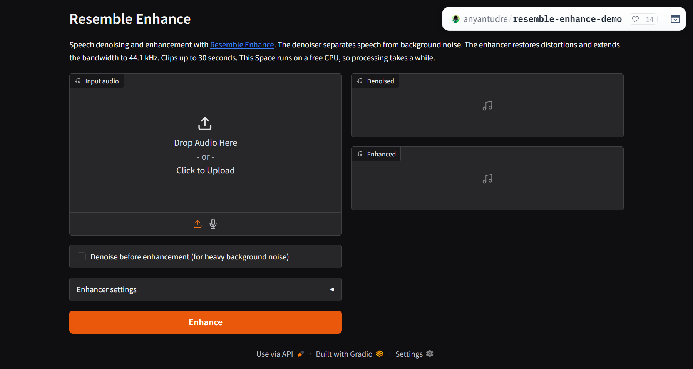

<h1 align="center">Resemble Enhance Demo</h1>

<p align="center">
  <a href="https://huggingface.co/spaces/anyantudre/resemble-enhance-demo"></a>
  <a href="https://github.com/anyantudre/resemble-enhance-demo/actions/workflows/sync-space.yml"></a>
  <a href="LICENSE"></a>
</p>

A Gradio demo of [Resemble Enhance](https://github.com/resemble-ai/resemble-enhance), a speech denoising and enhancement model from Resemble AI. It runs on a free CPU Space on Hugging Face and redeploys from this repository through GitHub Actions.

Try it at [huggingface.co/spaces/anyantudre/resemble-enhance-demo](https://huggingface.co/spaces/anyantudre/resemble-enhance-demo).



## How it works

Resemble Enhance has two models. The denoiser separates speech from background noise. The enhancer restores distortions and extends the bandwidth, so the output is 44.1 kHz speech.

Upload or record a clip and the demo returns the denoised and the enhanced version. On the free CPU Space, clips are capped at 30 seconds and processing is slow. The enhancer settings (ODE solver, number of function evaluations, prior temperature) trade speed for quality.

## Run it locally

Requires Python 3.10 or newer.

```bash
git clone https://github.com/anyantudre/resemble-enhance-demo.git
cd resemble-enhance-demo
python -m venv .venv
source .venv/bin/activate   # Windows: .venv\Scripts\activate
pip install -r requirements.txt
python app.py
```

The model weights (about 700 MB) download from [ResembleAI/resemble-enhance](https://huggingface.co/ResembleAI/resemble-enhance) on the first start. `requirements.txt` installs the CPU build of PyTorch. For a GPU, install a CUDA build of `torch` and `torchaudio` 2.8.0 first. Add `--unlimited` to accept clips of any length.

To process a folder of files from the command line:

```bash
python -m resemble_enhance.enhancer in_dir out_dir --device cpu
python -m resemble_enhance.enhancer in_dir out_dir --device cpu --denoise_only
```

## Deployment

[`.github/workflows/sync-space.yml`](.github/workflows/sync-space.yml) uploads the repository to the Space on every push to `main`. It needs an `HF_TOKEN` repository secret: a Hugging Face access token with write access to the Space.

## Training

Training needs a CUDA GPU and DeepSpeed. Install the extra dependencies with `pip install -r requirements-train.txt`, then follow [Usage.md](Usage.md), which keeps the upstream training guide.

## Credits

The model, weights and the `resemble_enhance` package are by [Resemble AI](https://www.resemble.ai/enhance/), released under the MIT License. This repository vendors the package from [resemble-ai/resemble-enhance](https://github.com/resemble-ai/resemble-enhance) (commit `d20c372`) with one change: the inference code does not import DeepSpeed, so the demo runs without it.
